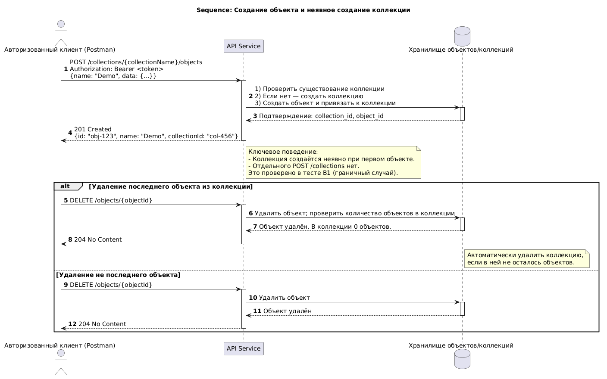
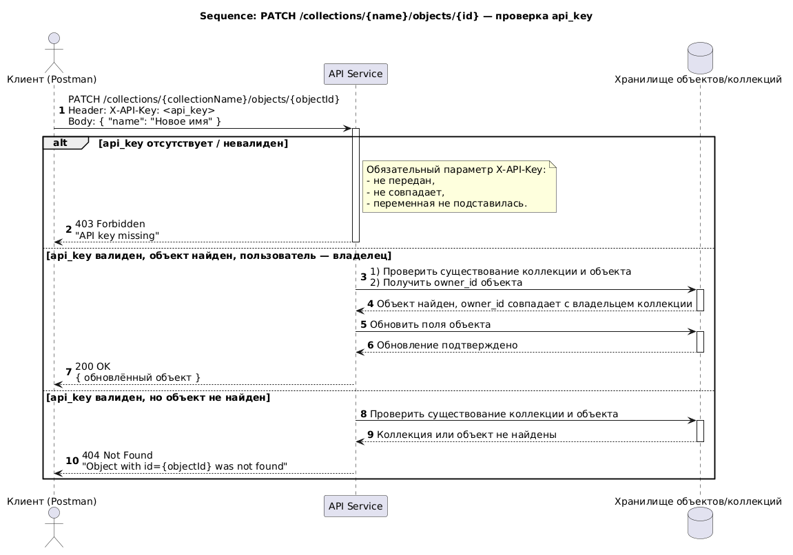

# Архитектурные диаграммы

Здесь собраны ключевые диаграммы системы. 

- Картинки (PNG) — для наглядности на сайте.
- Исходные коды диаграмм (PlantUML `.puml`) хранятся **внутри папки `docs/diagrams/plantuml`** специально для этого портфолио, 
чтобы можно было быстро посмотреть код прямо на сайте. В большом проекте я бы вынесла их в корень репозитория, но здесь это удобно для демонстрации.

## Диаграмма вариантов использования

Диаграмма вариантов использования (Use Case) показывает, кто взаимодействует с API и какие сценарии доступны.

*Исходный код этой диаграммы: [uc-01.puml](diagrams/plantuml/uc-01.puml)*

## Диаграмма классов

Диаграмма классов отражает контракт API (какие поля приходят в JSON), а не внутреннюю реализацию БД.
Подходит для: описания эндпоинтов, привязки к тестам (P1.1, N1), примеров в Postman.

*Исходный код этой диаграммы: [class-01.puml](diagrams/plantuml/class-01.puml)*

## Диаграммы последовательности

### Создание объекта

Диаграмма показывает поведение API  при создании объекта через эндпоинт POST /collections/{name}/objects.
Ключевые моменты для тестов и интеграции:

- Неявное создание: коллекция создаётся автоматически при добавлении первого объекта (нет отдельного метода создания).
- Композиция: при удалении последнего объекта коллекция удаляется (автоматически на уровне сервиса/БД).
- Статус-коды: 201 на создание, 204 на удаление, 404 при обращении к удалённой коллекции.

*Исходный код этой диаграммы: [seq-01.puml](diagrams/plantuml/seq-01.puml)*

### Обновление объекта (авторизованный пользователь)

Для PATCH /collections/{collectionName}/objects/{objectId} используется API-ключ вместо JWT‑токена:

Обязательный заголовок: X-API-Key.
Отсутствие или невалидность ключа → 403 Forbidden (без обращения к базе данных).
После проверки ключа API проверяет существование коллекции/объекта и права владельца.

*Исходный код этой диаграммы: [seq-02.puml](diagrams/plantuml/seq-02.puml)*

## ER-диаграмма

>ER-диаграмма (от англ. Entity-Relationship Diagram — диаграмма «сущность-связь») — это графическая схема, 
>которая наглядно показывает, какие данные есть в системе и как они связаны между собой. 

> - Сущность (Entity) — это «объект», про который мы храним данные. В терминах БД — это таблица (*collection*, *object*)
> - Атрибут (Attribute) — характеристика сущности. В БД — колонка таблицы (*id*, *data*)
> - Первичный ключ (PK, Primary Key) — уникальный идентификатор строки. Без него нельзя однозначно обратиться к записи.
> - Внешний ключ (FK, Foreign Key) — ссылка на PK другой таблицы. Показывает связь.
> - Связь (Relationship) — как сущности «относятся» друг к другу («одна коллекция содержит много объектов»).
> - Кардинальность — сколько экземпляров одной сущности связано с экземпляром другой («Один ко многим» (1:N): одна коллекция → много объектов).