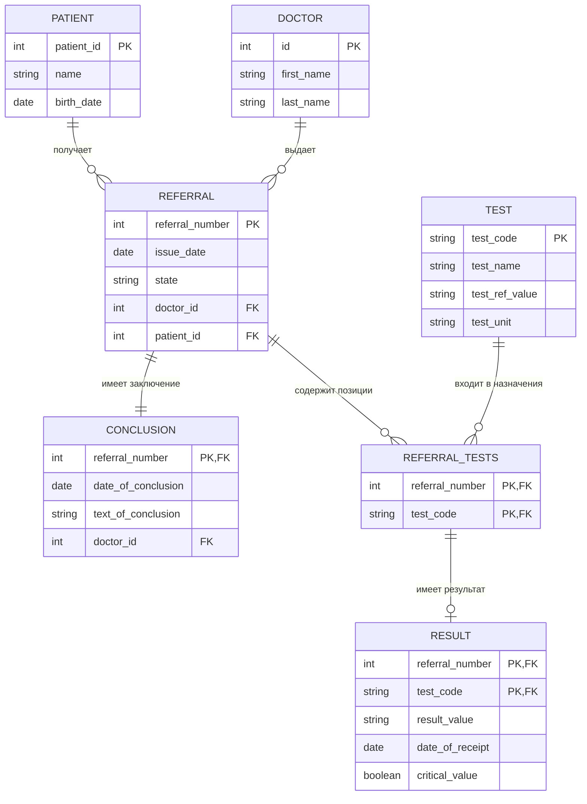

## ER-диаграмма: учёт лабораторных исследований

Диаграмма отражает модель данных для направлений, назначенных анализов, результатов и заключений.

### Гарантии целостности

- **Состав направления и результаты:** результат можно записать только для реально назначенного анализа (FK на составной ключ `REFERRAL_TESTS`).  
- **1:0..1 для результата:** у одной позиции направления — ровно один результат или ноль (составной PK в `RESULT`).  
- **1:1 для заключения:** у направления ровно одно заключение (PK `referral_number` в `CONCLUSION`).  
- **Статусы:** допустимые значения фиксируются на уровне БД через `CHECK`.  
- **Нормализация:** транзитивные зависимости минимизированы; `doctor_id` в `CONCLUSION` отражает автора заключения, а не дублирует врача направления.
